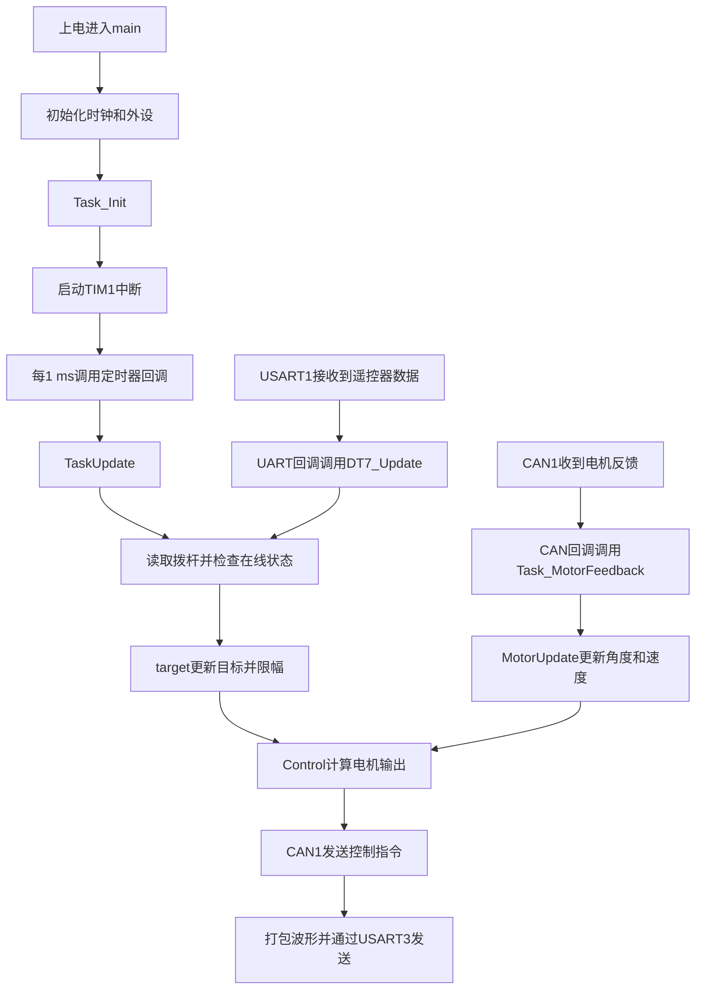

# motor_example 项目入门与模块使用说明

本文面向刚接触 STM32 和嵌入式开发的同学，以本项目当前代码为例，说明程序如何运行、各目录负责什么、模块提供哪些接口，以及修改功能时应该从哪里入手。

阅读时建议同时打开 `Core/Src/main.c`、`User/core/App/task.c` 和 `User/core/App/callback.c`。本文描述的是当前实现，标为“预留”或“待完善”的部分不能当作已经完成的功能使用。

## 目录

- [1. 这个项目实现了什么](#1-这个项目实现了什么)
- [2. 先认识几个基础概念](#2-先认识几个基础概念)
- [3. 项目目录怎么分类](#3-项目目录怎么分类)
- [4. 程序从上电到控制电机的过程](#4-程序从上电到控制电机的过程)
- [5. Core：芯片和外设初始化](#5-core芯片和外设初始化)
- [6. App：应用层](#6-app应用层)
- [7. Bsp：串口和CAN接口](#7-bsp串口和can接口)
- [8. Remote：DT7遥控器](#8-remotedt7遥控器)
- [9. Motor：电机反馈与数据打包](#9-motor电机反馈与数据打包)
- [10. Alg：PID控制](#10-algpid控制)
- [11. Tool：限幅与波形数据](#11-tool限幅与波形数据)
- [12. 跟着当前例子走一遍](#12-跟着当前例子走一遍)
- [13. 编译和J-Link下载](#13-编译和j-link下载)
- [14. 新增或修改功能时改哪里](#14-新增或修改功能时改哪里)
- [15. 当前实现的边界与常见问题](#15-当前实现的边界与常见问题)

## 1. 这个项目实现了什么

这是一个基于 **STM32F427IIH6** 的双电机云台控制示例。Yaw 表示水平转动，Pitch 表示俯仰转动。

当前程序完成的主要流程是：通过 USART1 接收遥控器数据，根据拨杆选择模式，根据摇杆改变云台目标角度，再用两层 PID 算出电机控制指令，经 CAN1 发送。电机同时通过 CAN1 返回角度、速度、电流和温度。USART3 用来向电脑发送波形数据，方便观察控制效果。

| 功能 | 当前实现 |
| --- | --- |
| 遥控器接收 | USART1 + DMA空闲接收，按18字节解析DT7数据 |
| 模式选择 | 停机、手动、视觉三种状态 |
| 手动控制 | 摇杆改变Yaw、Pitch目标角度 |
| 角度限制 | 各自首次累计角度的 ±90° |
| 电机反馈 | 解析两台电机的CAN反馈并换算物理量 |
| 控制算法 | 每轴一个角度PID和一个速度PID |
| 断联处理 | 任意电机或遥控器不在线时切换停机 |
| 波形发送 | 9路float数据，通过USART3 DMA发送 |
| 视觉控制 | 已有状态和函数入口，具体控制尚未实现 |
| 编译下载 | CMake + Ninja + Arm GCC；J-Link下载 |

“已有控制流程”不等于“所有轴都已经调好”。当前Pitch的PID增益为零，具体硬件配置、接线和参数还需要与实物配套。

## 2. 先认识几个基础概念

| 名称 | 在这个项目中的含义 |
| --- | --- |
| MCU / 单片机 | STM32芯片，执行程序并控制外设 |
| 外设 | 芯片内部的串口、CAN、定时器、DMA等硬件 |
| HAL | ST提供的硬件操作库，例如 `HAL_CAN_AddTxMessage()` |
| BSP | 对硬件操作的进一步封装，例如本项目的 `sendCAN()` |
| API / 接口 | 模块提供给其他代码调用的函数 |
| 句柄 | 保存外设状态的结构体，例如 `hcan1`、`huart1`、`htim1` |
| 中断 | 硬件事件发生后，让CPU进入对应的处理函数 |
| 回调 | HAL处理事件后，调用用户实现的函数 |
| DMA | 由硬件搬运数据，减少CPU逐字节收发的工作 |
| 反馈 | 电机实际测到的角度、速度等信息 |
| 目标 | 希望电机达到的角度或速度 |
| 控制输出 | 根据目标与反馈计算出的指令，不一定就是角度或电流值 |

例如：

```c
sendCAN(&hcan1, Can_TX_1.txHeader, Can_TX_1.txdata, 0x1FF, 0);
```

`hcan1` 表示CAN1，`&hcan1` 是它的地址；函数通过这个地址找到要使用的外设。`0x1FF` 是报文ID，不是芯片地址，也不是电机角度。

### 2.1 `.h` 和 `.c` 的分工

`.h` 头文件通常写结构体和函数声明，让其他文件知道“这个模块提供什么”。`.c` 源文件写变量定义和函数实现，说明“具体怎么做”。

```c
// tool.h：声明，告诉其他文件这里有这个变量和函数
extern uint8_t send_str2[sizeof(float) * 10];
float clamp(float value, float min, float max);
```

```c
// tool.c：定义，真正分配变量空间和实现函数
uint8_t send_str2[sizeof(float) * 10];

float clamp(float value, float min, float max)
{
    if (value > max) return max;
    if (value < min) return min;
    return value;
}
```

普通全局变量和普通函数的实现不要在头文件中重复定义，否则多个 `.c` 引用后可能出现 `multiple definition` 链接错误。

`static Motor_t motor[2]` 中的 `static` 表示这个数组只在 `task.c` 内可见。在其他文件中直接写 `motor[0]` 是无法访问它的；本文中操作该数组的示例均放在 `task.c` 内理解。

### 2.2 本项目常用的单位

| 数量 | 单位与换算 |
| --- | --- |
| 角度 | `deg` 为度，`rad` 为弧度；180° = π rad |
| 90° | 约 `1.5707963f` rad |
| 时间间隔 | PID的 `dt` 使用秒；1 ms = `0.001f` s |
| 转速 | `rpm` 为每分钟转数，`rad/s` 为每秒弧度 |
| 转速换算 | `rad/s = rpm × 2π / 60` |
| 电流 | `A` |
| 力矩 | `N·m`，当前模块根据电流估算 |

PID的目标和反馈必须使用相同单位。例如角度目标是rad，就应使用 `getTotalAngleRad()` 作为反馈。

## 3. 项目目录怎么分类

```text
motor_example/
├─ Core/                         芯片和外设初始化，主要由CubeMX生成
│  ├─ Inc/                       外设头文件、配置和句柄声明
│  └─ Src/                       main、时钟、中断入口和外设初始化
├─ Drivers/                      ST提供的HAL和CMSIS底层库
│  ├─ CMSIS/                     Cortex-M内核和STM32设备定义
│  └─ STM32F4xx_HAL_Driver/       GPIO、CAN、UART、TIM等HAL驱动
├─ User/
│  └─ core/
│     ├─ App/                    将各模块组合成实际应用
│     │  ├─ task.c / task.h      初始化、目标、控制和发送任务
│     │  ├─ fsm.c / fsm.h        模式状态机
│     │  └─ callback.c           定时器、CAN和UART回调
│     └─ Modules/                可以分别理解和复用的功能模块
│        ├─ Bsp/
│        │  ├─ user_can.c / .h   CAN过滤器和发送封装
│        │  └─ user_uart.c / .h  串口中断、阻塞和DMA收发封装
│        ├─ Remote/
│        │  └─ DT7.c / DT7.h     遥控器协议解析
│        ├─ Motor/
│        │  └─ motor.c / .h      电机反馈换算、首次角度和指令打包
│        ├─ Alg/
│        │  ├─ pid.h            PID结构体和接口声明
│        │  └─ pld.c            PID实现，注意当前文件名是pld.c
│        └─ Tool/
│           └─ tool.c / .h       clamp和波形数据打包
├─ cmake/                        编译工具链和CubeMX构建配置
├─ CMakeLists.txt                项目的总构建入口
├─ CMakePresets.json             Debug、Release构建预设
├─ startup_stm32f427xx.s          芯片启动代码和中断向量表
├─ STM32F427xx_FLASH.ld           链接脚本，安排Flash和RAM布局
├─ motor_example.ioc             CubeMX工程，可用图形界面调整外设
├─ build.bat / build.ps1          Windows编译入口和实现
├─ download.bat / download.ps1    Windows J-Link下载入口和实现
├─ build.sh / download.sh         Bash环境下的编译和下载脚本
├─ Makefile                      Bash脚本的make入口
├─ .clangd                       clangd索引配置
├─ .vscode/settings.json         编辑器项目配置
├─ BUILD.md                      编译下载的专门说明
└─ build/                        生成的固件、编译数据库和临时验证文件
```

常见的修改位置：外设引脚和串口参数在 `Core`；遥控器解析在 `Remote`；电机换算在 `Motor`；控制策略、目标角度、模式切换在 `App`。通常不需要修改 `Drivers`。

## 4. 程序从上电到控制电机的过程

### 4.1 初始化顺序

当前 `main()` 的主要流程如下：

```c
HAL_Init();
SystemClock_Config();

MX_GPIO_Init();
MX_DMA_Init();
MX_CAN1_Init();
MX_CAN2_Init();
MX_USART1_UART_Init();
MX_USART3_UART_Init();
MX_TIM1_Init();

Task_Init();
__HAL_TIM_CLEAR_FLAG(&htim1, TIM_FLAG_UPDATE);
HAL_TIM_Base_Start_IT(&htim1); // 实际代码还检查了返回值

while (1)
{
}
```

`MX_..._Init()` 先配置硬件，`Task_Init()` 再配置应用模块、启动CAN1和遥控器接收，最后启动TIM1周期中断。

主循环为空，程序仍然可以工作，因为当前业务主要放在中断回调中运行。这个工程没有使用RTOS；文件名中的“task”是应用任务的意思，不是操作系统线程。

### 4.2 周期控制与异步反馈



遥控器和电机反馈在各自收到数据时更新，不是每次PID执行时主动向设备读取。控制任务使用的是最近收到的一份反馈。

### 4.3 中断入口和回调有什么区别

以TIM1为例：

```text
TIM1计时到达设定值
→ Core/Src/stm32f4xx_it.c：TIM1_UP_TIM10_IRQHandler()
→ HAL_TIM_IRQHandler(&htim1)
→ User/core/App/callback.c：HAL_TIM_PeriodElapsedCallback()
→ TaskUpdate()
```

外设中断入口负责把事件交给HAL，回调负责执行用户业务。学习本项目时，先理解 `callback.c` 中的用户逻辑，再往底层查。

## 5. Core：芯片和外设初始化

### 5.1 文件与职责

| 文件 | 作用 / 常用入口 |
| --- | --- |
| `main.c` / `main.h` | `main()`、`SystemClock_Config()`、`Error_Handler()` |
| `gpio.c` / `gpio.h` | `MX_GPIO_Init()`，配置通用引脚 |
| `dma.c` / `dma.h` | `MX_DMA_Init()`，使能DMA时钟和相关中断 |
| `can.c` / `can.h` | `MX_CAN1_Init()`、`MX_CAN2_Init()`；定义/声明 `hcan1`、`hcan2` |
| `usart.c` / `usart.h` | `MX_USART1_UART_Init()`、`MX_USART3_UART_Init()`；串口和DMA关联 |
| `tim.c` / `tim.h` | `MX_TIM1_Init()`；定义/声明 `htim1` |
| `stm32f4xx_it.c` / `.h` | 芯片异常和外设中断入口 |
| `stm32f4xx_hal_msp.c` | HAL底层初始化钩子；外设专属MSP实现也分布在对应外设源文件中 |
| `system_stm32f4xx.c` | 系统底层初始化和时钟相关支持 |
| `syscalls.c` / `sysmem.c` | C运行库所需的系统调用和内存支持 |
| `stm32f4xx_hal_conf.h` | 选择启用哪些HAL模块及配置晶振等参数 |

CubeMX会生成带 `USER CODE BEGIN` / `USER CODE END` 的区域。需要手写的初始化调用，放在合适的用户区域，避免重新生成代码后丢失。

### 5.2 当前例子的外设配置

| 外设 | 当前配置与用途 |
| --- | --- |
| 主时钟 | 配置以12 MHz外部晶振为基础，系统时钟180 MHz |
| CAN1 | PD0为RX、PD1为TX；用于两个电机的收发 |
| CAN2 | PB12为RX、PB13为TX；有初始化代码，但应用尚未完整启用 |
| CAN波特率 | 按当前45 MHz外设时钟和位时序计算为1 Mbps |
| USART1 | PB7为RX、PB6为TX；100000波特率、偶校验、1停止位，供遥控器使用 |
| USART3 | PD9为RX、PD8为TX；115200波特率、8数据位、无校验、1停止位，供波形发送使用 |
| TIM1 | 180 MHz计数时钟，预分频180、计数1000次，周期1 ms |
| DMA | USART1接收、USART3接收与发送已配置，使用普通模式 |

USART1在HAL中设置的是9位字长加偶校验，有效数据位为8位，不能简单把配置理解成“9个有效数据位”。

上述引脚是STM32侧的信号。CAN收发还需要板上的CAN收发器；不能把MCU的TX/RX脚直接当成CAN_H/CAN_L。具体插座和电源连接要看所使用开发板的原理图。

## 6. App：应用层

### 6.1 `task.c` / `task.h`：把模块组合起来

`task.c` 管理两个电机、四个PID、目标角度和控制输出。底层模块负责一件具体事情，应用层决定这些事情按什么顺序发生。

| 数据 | 当前用途 |
| --- | --- |
| `motor[0]` | Yaw电机状态，只在task.c内可见 |
| `motor[1]` | Pitch电机状态，只在task.c内可见 |
| `gimbal_target.target_gimbal_yaw` | Yaw目标角度，rad |
| `gimbal_target.target_gimbal_pitch` | Pitch目标角度，rad |
| `gimbal_out.out_gimbal_yaw` | Yaw最终控制指令 |
| `gimbal_out.out_gimbal_pitch` | Pitch最终控制指令 |
| `pid_yaw_angle` / `pid_pitch_angle` | 两个轴的角度环 |
| `pid_yaw_velocity` / `pid_pitch_velocity` | 两个轴的速度环 |
| `CONTROL_DT_S` | PID控制周期，目前为0.001秒 |
| `TARGET_ANGLE_RANGE_RAD` | 相对首次角度的单侧范围，目前为π/2 |

对外声明的应用API：

| API | 作用 | 何时调用 |
| --- | --- | --- |
| `Task_Init(void)` | 初始化状态机、电机、遥控器和PID，并启动接收 | main中外设初始化后调用一次 |
| `TaskUpdate(void)` | 执行完整的一次控制周期 | 当前由TIM1每1 ms调用 |
| `Task_MotorFeedback(can_id, data)` | 按反馈ID把数据分给对应电机 | CAN接收回调中调用 |

`task.c` 内部使用的函数如下。这些函数没有作为头文件中的公共接口提供，通常在应用层内部修改即可。

| 函数 | 作用 |
| --- | --- |
| `is_connected()` | 两个电机和遥控器都在线才返回true，当前超时均为1000 ms |
| `target()` | 根据模式更新目标角度，然后做首次角度±90°限幅 |
| `Stop()` | 清空PID状态，将两个电机输出设为零 |
| `Manual()` | 分别计算Yaw、Pitch的角度环与速度环 |
| `Vision()` | 视觉控制预留，目前为空 |
| `Control()` | 根据状态调用Stop、Manual或Vision |
| `motor_control_logic()` | 将两个输出打包到两份缓冲区，经CAN1发送 |

#### 6.1.1 一个周期内的顺序

```c
FSM_Update();
if (!is_connected())
{
    FSM_HandleEvent(FSM_EVENT_STOP);
}
target();
Control();
motor_control_logic();
```

先读取拨杆，再检查掉线。因此即使拨杆选择手动，只要任意设备不在线，这个周期仍然执行停机。掉线条件消失后，后续周期会重新按拨杆选择模式，停机不是必须手动解除的锁存状态。

#### 6.1.2 当前目标角度怎么改变

```c
// task.c中手动模式的当前写法
gimbal_target.target_gimbal_yaw += 3.14f * get_left_y() * 0.001f;
gimbal_target.target_gimbal_pitch += 1.54f * get_right_x() * 0.001f;
```

摇杆值归一化到[-1, 1]。Yaw系数3.14的单位是rad/s，再乘0.001秒，得到这一个周期要增加的角度。摇杆松开到零时，目标不再增加，因此这是“摇杆控制目标移动速度”的写法。

例如Yaw输入持续为0.5，0.1秒内的目标增量约为 `3.14 × 0.5 × 0.1 = 0.157 rad`，约9°，到限幅边界后停止继续增长。

当前限幅写法：

```c
const float initial_yaw = getInitialAngleRad(&motor[0]);
const float initial_pitch = getInitialAngleRad(&motor[1]);

gimbal_target.target_gimbal_yaw = clamp(gimbal_target.target_gimbal_yaw,
    initial_yaw - TARGET_ANGLE_RANGE_RAD,
    initial_yaw + TARGET_ANGLE_RANGE_RAD);
gimbal_target.target_gimbal_pitch = clamp(gimbal_target.target_gimbal_pitch,
    initial_pitch - TARGET_ANGLE_RANGE_RAD,
    initial_pitch + TARGET_ANGLE_RANGE_RAD);
```

Yaw和Pitch各自使用自己的首次累计角度。这个限制约束的是目标值，不是机械限位装置，也不能保证实际轴位置绝不因惯性或外力超出范围。

### 6.2 `fsm.c` / `fsm.h`：模式状态机

状态机用于回答“现在该运行哪一种控制逻辑”。`FsmState_t` 为当前状态，`FsmEvent_t` 为请求切换状态的事件。

| 状态 | 事件 | 当前行为 |
| --- | --- | --- |
| `FSM_STATE_STOP` | `FSM_EVENT_STOP` | 清空PID并发送零控制输出 |
| `FSM_STATE_MANUAL` | `FSM_EVENT_ENTER_MANUAL` | 摇杆更新目标，执行串级PID |
| `FSM_STATE_VISION` | `FSM_EVENT_ENTER_VISION` | 进入预留视觉分支，目前没有具体控制 |

| API | 作用 |
| --- | --- |
| `FSM_Init()` | 将状态设为STOP |
| `FSM_Update()` | 读取拨杆并将对应事件交给FSM_HandleEvent |
| `FSM_HandleEvent(event)` | 根据事件直接切换状态；未知事件保持原状态 |
| `FSM_GetState()` | 返回当前状态 |
| `read_mode_event()` | 文件内部静态函数，负责将拨杆组合映射为事件 |

当前拨杆判断以代码中的 `get_s1()`、`get_s2()` 为准：

| s1（代码中的左拨杆） | s2（代码中的右拨杆） | 模式 |
| --- | --- | --- |
| 中，值3 | 下，值2 | 手动 |
| 下，值2 | 中，值3 | 视觉 |
| 其余组合 | 其余组合 | 停机 |

如何使用：

```c
// 这里只是调用方法，正常周期内已经由TaskUpdate执行状态更新
FSM_HandleEvent(FSM_EVENT_STOP);
FsmState_t mode = FSM_GetState();
```

单独调用一次 `FSM_HandleEvent(STOP)`，并不代表永远停机：下一个周期的 `FSM_Update()` 仍可能按拨杆切回手动。

### 6.3 `callback.c`：硬件事件与业务逻辑之间的连接

| 回调 | 当前处理 |
| --- | --- |
| `HAL_TIM_PeriodElapsedCallback(htim)` | 仅处理TIM1：执行TaskUpdate，再打包和发送波形 |
| `HAL_CAN_RxFifo0MsgPendingCallback(hcan)` | 仅处理CAN1：从FIFO0取出标准8字节数据帧，交给Task_MotorFeedback |
| `HAL_CAN_RxFifo1MsgPendingCallback(hcan)` | 当前写了CAN2分支，但实现尚需完善，见第15节 |
| `HAL_UARTEx_RxEventCallback(huart, size)` | 仅处理USART1：收到18字节时解析遥控器，随后重新启动DMA空闲接收 |

普通模式DMA接收一轮结束后，不会自动无限重复本次接收，所以UART回调中会再次调用 `Receive_dma_idle()`。

回调由HAL调用，不要在 `while(1)` 中手动反复调用这些函数来模拟硬件事件。中断中也不应加入长时间等待、`HAL_Delay()` 或大量阻塞输出，否则会影响其他外设的数据处理。

## 7. Bsp：串口和CAN接口

### 7.1 `user_uart.c` / `user_uart.h`

该模块封装串口收发方式，不负责解析遥控器或生成波形内容。

| API | 方式 | 参数含义 | 返回值 |
| --- | --- | --- | --- |
| `Transmit(huart, buffer, size)` | 中断发送 | 句柄、发送缓冲区、字节数 | true表示成功启动 |
| `Receive(huart, buffer, size)` | 中断接收 | 句柄、接收缓冲区、字节数 | true表示成功启动 |
| `Transmit_byte(huart, byte)` | 阻塞发送1字节 | 句柄、字节值 | true表示发送完成 |
| `Receive_byte(huart, byte)` | 阻塞接收1字节 | 句柄、存放接收字节的地址 | true表示接收完成 |
| `Transmit_dma(huart, buffer, size)` | DMA发送 | 句柄、缓冲区、字节数 | true表示成功启动 |
| `Receive_dma(huart, buffer, size)` | DMA接收 | 句柄、缓冲区、字节数 | true表示成功启动 |
| `Receive_dma_idle(huart, buffer, size)` | DMA空闲接收 | 句柄、接收缓冲区、容量 | true表示成功启动 |

阻塞单字节收发最多等待100 ms。中断和DMA接口的true表示“启动成功”，不表示全部字节已经发完或接收完成；false可能是参数无效、DMA未配置、串口忙或HAL启动失败。

当前例子的使用：

```c
// Task_Init中：启动遥控器接收
Receive_dma_idle(&huart1, remote_rx_buffer, sizeof(remote_rx_buffer));

// 定时器回调中：发送已经打包好的波形数据
Transmit_dma(&huart3, send_str2, sizeof(send_str2));
```

`Receive_dma_idle()` 启动后关闭逐字节RXNE中断和DMA半传输中断，主要处理空闲事件或缓冲区接满事件。`DT7_Update()` 则由UART回调在长度等于18时调用。

发送或接收尚未完成时，缓冲区必须仍然有效。DMA发送时也不要改写正在发送的缓冲区。例如函数内的普通局部数组在函数返回后失效，不适合直接作为长期异步传输的存储。

### 7.2 `user_can.c` / `user_can.h`

| 类型 / 变量 | 作用 |
| --- | --- |
| `Can_RX` | 一份接收帧头 `rxHeader` 和8字节接收数据 `rxdata` |
| `Can_TX` | 一份发送帧头 `txHeader` 和8字节发送数据 `txdata` |
| `Can_RX_` | 当前共用的接收存储 |
| `Can_TX_1` | Yaw指令的发送存储 |
| `Can_TX_2` | Pitch指令的发送存储 |

`CAN_ConfigFilter()` 当前只配置CAN1：使用过滤器0、接收到FIFO0，ID和掩码均为零，接受所有ID；然后启动CAN1并启用接收通知。虽然启用了FIFO0和FIFO1通知，当前过滤器把报文分配到的是FIFO0。

发送API的完整形式：

```c
void sendCAN(CAN_HandleTypeDef *hcan,
             CAN_TxHeaderTypeDef canheader,
             uint8_t tx_data[8],
             uint32_t sendCAN_ID,
             uint32_t txMailbox);
```

| 参数 | 如何理解 |
| --- | --- |
| `hcan` | 选择使用哪一路CAN，例如 `&hcan1` |
| `canheader` | 帧头结构体；函数内设置标准ID、标准帧、数据帧和DLC=8 |
| `tx_data` | 实际要发送的8字节数据 |
| `sendCAN_ID` | 整帧的CAN ID，例如0x1FF |
| `txMailbox` | 局部邮箱编号变量，由HAL写入；当前按值传递，不会把编号传回调用者 |

帧头描述“发给哪个报文ID、数据长度和帧类型”，数据区保存“具体发什么”。`setCAN()` 负责填数据，`sendCAN()` 负责提交发送，这是两个不同步骤。

当前代码示例：

```c
setCAN(Can_TX_1.txdata, (int16_t)gimbal_out.out_gimbal_yaw, 1);
sendCAN(&hcan1, Can_TX_1.txHeader, Can_TX_1.txdata, 0x1FF, 0);

setCAN(Can_TX_2.txdata, (int16_t)gimbal_out.out_gimbal_pitch, 2);
sendCAN(&hcan1, Can_TX_2.txHeader, Can_TX_2.txdata, 0x2FE, 0);
```

两帧都走CAN1，但使用不同报文ID和不同缓冲区。当前源码在调用 `setCAN()` 时使用隐式float转int16_t，上面显式写出转换，方便看清数据类型。

`sendCAN()` 先检查是否有空邮箱，再调用 `HAL_CAN_AddTxMessage()`；邮箱满时直接不发，没有等待或软件排队。当前函数返回void，也没有向调用者报告HAL发送结果，因此执行过这一行不等于电机一定收到。

## 8. Remote：DT7遥控器

文件：`Remote/DT7.c`、`Remote/DT7.h`。

### 8.1 实现了什么

模块从一帧18字节数据中提取4个摇杆通道、两个拨杆和滚轮，然后做减中值、死区和归一化处理。键盘鼠标部分当前没有解析。

```text
18字节数据
→ channels：协议原始值，中值约1024
→ coordinates：减去1024，处理死区
→ stick_position：除以660，并限制到[-1, 1]
```

`DT7_t remote_DT7` 保存遥控器数据和最近接收时间：

| 字段 | 作用 |
| --- | --- |
| `channels` | 原始通道、拨杆和滚轮 |
| `coordinates` | 减中值并处理死区后的坐标 |
| `stick_position` | 归一化后的摇杆和滚轮 |
| `deadzone` | 死区，单位为原始通道相对中值的偏移量 |
| `last_receive_tick` | 最近解析时间，ms |
| `received` | 是否至少收到过数据 |
| `is_connect` | 最近一次在线检查的结果 |

死区20表示绝对偏移小于20时按零处理，用于避免摇杆松开后的小抖动产生控制输入。

### 8.2 API清单

| API | 用法和作用 |
| --- | --- |
| `DT7_Init(deadzone)` | 初始化接收状态并设置死区；当前使用20.0f |
| `DT7_Update(data)` | 解析18字节数据并记录接收时间；调用者负责保证长度 |
| `DT7_SetDeadzone(deadzone)` | 设置死区，负值按零处理 |
| `DT7_IsConnected(timeout_ms)` | 按指定超时检查在线，并更新is_connect |
| `DT7_GetOnline()` | 使用100 ms默认超时检查在线 |
| `get_ch0()` / `get_ch1()` | 读取右摇杆左右 / 前后原始通道 |
| `get_ch2()` / `get_ch3()` | 读取左摇杆左右 / 前后原始通道 |
| `get_scroll()` | 读取滚轮原始值 |
| `get_s1()` / `get_s2()` | 读取拨杆编码：上1、中3、下2 |
| `get_left_x()` / `get_left_y()` | 读取左摇杆前后 / 左右归一化输入 |
| `get_right_x()` / `get_right_y()` | 读取右摇杆前后 / 左右归一化输入 |
| `get_scroll_()` | 读取滚轮归一化输入，注意和get_scroll名称不同 |
| `get_online()` | 头文件中有声明，当前源文件未实现，暂不要调用 |

例如：

```c
float yaw_input = get_left_y();     // 当前例子使用左摇杆左右控制Yaw
float pitch_input = get_right_x();  // 当前例子使用右摇杆前后控制Pitch
bool online = DT7_IsConnected(1000);
```

这里的x/y命名遵循项目现有映射：x是前后、y是左右，不要凭其他项目的习惯反过来理解。

`DT7_Update()` 当前没有完整的通道合法性、同步和校验处理；应用回调主要通过“是否恰好18字节”决定是否解析。在线表示最近收到并解析过数据，不代表已经完成完整的通信质量判断。

## 9. Motor：电机反馈与数据打包

文件：`Motor/motor.c`、`Motor/motor.h`。

### 9.1 三个结构体各管什么

| 结构体 | 用途 |
| --- | --- |
| `MotorParams_t` | 保存电机型号相关的换算参数 |
| `MotorRawData_t` | 保存从CAN反馈直接拆出的整数 |
| `Motor_t` | 保存参数、原始反馈、换算结果、首次角度和在线信息 |

当前初始化参数如下，它们是程序中的换算配置，不会自动写入电机固件：

```c
const MotorParams_t dji6020_params = {
    .reduction_ratio = 1.0f,         // 转子转速 / 输出轴转速
    .torque_constant = 0.741f,       // 力矩估算常数，N·m/A
    .feedback_current_max = 16384.0f,
    .current_max = 3.0f,
    .encoder_resolution = 8192.0f,  // 一圈编码器计数
};

Motor_Init(&motor[0], &dji6020_params);
Motor_Init(&motor[1], &dji6020_params);
```

### 9.2 反馈解析与换算

本模块使用的反馈数据布局：

| 字节 | 内容 |
| --- | --- |
| 0、1 | 编码器角度，高字节在前 |
| 2、3 | 转子转速，有符号整数，单位rpm |
| 4、5 | 实际电流原始值，有符号整数 |
| 6 | 温度 |
| 7 | 当前未使用 |

收到一帧数据时，`MotorUpdate()` 更新：

```text
angle_deg = encoder × 360 / encoder_resolution
angle_rad = angle_deg × π / 180
speed_rpm = rotor_speed_rpm / reduction_ratio
speed_rad_s = speed_rpm × 2π / 60
current_a = feedback_current × current_max / feedback_current_max
torque_nm = current_a × torque_constant
```

单圈角度转过一圈会回到零，累计角度通过连续累加相邻反馈的角度变化，保留转过多圈的信息。例如359°到1°，模块按正转2°理解，而不是反转358°。

这种过零处理假设两次反馈之间的实际转角小于180°。如果大量反馈丢失或间隔过长，累计角度可能失去正确圈数。

### 9.3 API清单

| API | 作用 / 单位 |
| --- | --- |
| `Motor_Init(motor, params)` | 清零该实例并保存参数；再次调用会清除首次角度记录 |
| `MotorUpdate(motor, data)` | 解析8字节反馈、换算数据，并在首次反馈记录initial_angle_rad |
| `Motor_IsConnected(motor, timeout_ms)` | 检查接收时间，并更新is_connect |
| `setCAN(tx_data, data, id)` | 把int16_t指令写入8字节帧的指定槽位 |
| `getAngleDeg(motor)` | 转子单圈角度，deg |
| `getAngleRad(motor)` | 转子单圈角度，rad |
| `getTotalAngleDeg(motor)` | 输出轴累计角度，deg |
| `getTotalAngleRad(motor)` | 输出轴累计角度，rad |
| `getInitialAngleRad(motor)` | 首次反馈时的累计角度，rad |
| `getSpeedRpm(motor)` | 输出轴转速，rpm |
| `getSpeedRadS(motor)` | 输出轴角速度，rad/s |
| `getCurrentA(motor)` | 按配置换算的电流，A |
| `getTorqueNm(motor)` | 估算力矩，N·m |
| `getTemperatureC(motor)` | 温度，℃ |
| `getIsConnect(motor)` | 头文件有声明，当前源文件未实现，暂不要调用 |

当前反馈ID分配在 `Task_MotorFeedback()` 中完成：`0x205` 更新Yaw，`0x20A` 更新Pitch。电机模块本身不决定哪一个ID属于哪一轴。

### 9.4 首次角度的用法

解析时先保存 `first_feedback = !motor->received`，更新累计角度后，仅在首次反馈将其写入 `initial_angle_rad`。后续接收、断联和模式切换不会重新记录；重新上电或调用 `Motor_Init()` 才会开始新一轮记录。

```c
// 放在task.c内使用，motor数组在该文件内可见
float initial = getInitialAngleRad(&motor[0]);
float actual = getTotalAngleRad(&motor[0]);
float relative = actual - initial; // 相对首次位置的转角
```

首次角度是“当前累计角度算法的第一份结果”，不等同于机械零点，也没有单独进行回零校准。当前算法首帧仍与初始化时的0°比较，因此首帧单圈角度大于180°时，累计起点可能为负。例如首次单圈270°，累计起点为-90°。首次角度和后续累计角度使用相同坐标，所以相减及±90°限幅仍应使用这一对值，不要混用单圈角度。

还没收到反馈时，首次角度字段为初始化值零；当前应用通过在线检查让未收到反馈的电机保持停机。

### 9.5 `setCAN()` 的槽位是什么

8字节帧可以放4个16位指令：

| 传入的id | 对应字节 |
| --- | --- |
| 1 | tx_data[0]、tx_data[1] |
| 2 | tx_data[2]、tx_data[3] |
| 3 | tx_data[4]、tx_data[5] |
| 4 | tx_data[6]、tx_data[7] |

这里的 `id` 实际表示“这帧中的第几个槽位”，不是反馈CAN ID，也不总是电机拨码ID。当前Pitch是6号GM6020，使用第二组报文的第2槽，因此传2。

```c
uint8_t frame[8] = {0};
setCAN(frame, 1000, 1);  // 写入第1槽
setCAN(frame, -500, 2); // 写入第2槽
```

函数内部已按槽位计算偏移，始终传完整8字节数组首地址。不要为了选槽位传 `&frame[4]`，也不要直接把6传给本例的Pitch槽位参数。

## 10. Alg：PID控制

文件：`Alg/pid.h`、`Alg/pld.c`。当前实现文件确实叫 `pld.c`，查找PID算法时不要漏看它。

### 10.1 PID如何理解

PID根据目标和实际反馈的误差计算输出：

```text
error = target - feedback
P = kp × error
integral += error × dt
I = ki × integral
D = kd × (error - previous_error) / dt
output = P + I + D，再做输出限幅
```

P根据当前误差响应；I累积误差，用于补偿持续偏差；D根据误差变化率响应。三者输出的量纲取决于使用位置，不是所有PID的输出都叫电流。

当前实现还有积分限幅、积分分离，以及输出饱和时恢复本次更新前积分值的处理。dt非正数、NaN或无穷大时，返回旧输出，不更新PID状态。

### 10.2 API清单

| API | 作用 |
| --- | --- |
| `PID_Init(pid, kp, ki, kd, output_limit, integral_limit, threshold)` | 清零控制状态并设置参数 |
| `PID_Update(pid, target, feedback, dt)` | 执行一次PID计算并返回输出，dt单位秒 |
| `PID_Reset(pid)` | 清除误差、积分和输出等状态，保留PID参数 |
| `SetTarget(pid, target)` | 设置目标；PID_Update也会设置它 |
| `SetFeedback(pid, feedback)` | 设置反馈；PID_Update也会设置它 |
| `SetK(pid, kp, ki, kd)` | 修改增益 |
| `SetOutputLimit(pid, limit)` | 设置输出最大绝对值，取参数绝对值 |
| `SetIntegralLimit(pid, limit)` | 设置积分累积值限幅；非正数表示不限幅 |
| `SetIntegralSeparation(pid, threshold)` | 误差绝对值小于阈值才积分；零表示始终允许积分 |
| `getOutput(pid)` | 读取最近一次输出，不重新计算 |

`integral_limit` 限制的是积分状态，即“误差×秒”的累积量，不是直接限制I项输出；I项还需要乘ki。积分分离只是停止本次累积，不会自动清空之前已有的积分。

`PID_t` 里保存 `target`、`feedback`、`error`、`previous_error`、`integral`、`p_out`、`i_out`、`d_out` 和 `output`，可以在调试器中观察，也可以挑选部分值发给波形软件。

### 10.3 本项目的串级控制怎么使用

一个轴使用两个PID：

```text
目标角度rad ── 角度PID ── 目标角速度rad/s ── 速度PID ── 电机指令
                 ↑                               ↑
           实际累计角度rad                  实际角速度rad/s
```

当前Yaw初始化：

```c
PID_Init(&pid_yaw_angle, 100.0f, 3.0f, 0.0f,
         33.0f, 3.0f, 0.5f);
PID_Init(&pid_yaw_velocity, 1000.0f, 0.0f, 0.0f,
         25000.0f, 5000.0f, 2500.0f);
```

当前Yaw使用过程：

```c
PID_Update(&pid_yaw_angle,
           gimbal_target.target_gimbal_yaw,
           getTotalAngleRad(&motor[0]), CONTROL_DT_S);
float target_speed = getOutput(&pid_yaw_angle);

PID_Update(&pid_yaw_velocity,
           target_speed,
           getSpeedRadS(&motor[0]), CONTROL_DT_S);
gimbal_out.out_gimbal_yaw = clamp(getOutput(&pid_yaw_velocity),
                                -25000.0f, 25000.0f);
```

角度环输出最大33 rad/s，是给速度环的目标，不是发送给电机的角度。最后的Yaw输出才被转换成整数并打包。

当前Pitch两个PID的kp、ki、kd均为零，所以手动模式下即使目标变化，它的PID计算输出仍为零。这是当前参数状态，不是CAN发送必然有问题。

dt必须与实际调用周期一致。改TIM1周期时，需同步检查 `CONTROL_DT_S` 和 `target()` 中显式使用的 `0.001f`。使用带dt的PID时，旧的不带dt版本参数也不能直接认为具有相同含义。

## 11. Tool：限幅与波形数据

文件：`Tool/tool.c`、`Tool/tool.h`。

### 11.1 `clamp(value, min, max)`

将数值限制在指定范围，调用时需要保证min不大于max：

```c
float a = clamp(12.0f, -10.0f, 10.0f); // 10
float b = clamp(-12.0f, -10.0f, 10.0f); // -10
float c = clamp(3.0f, -10.0f, 10.0f); // 3
```

当前用于PID输出、积分累积值和目标角度的限幅。它只返回结果，不会自动修改传入变量，所以通常写 `value = clamp(value, min, max)`。

### 11.2 `vofa_send(x1, ..., x9)` 与 `send_str2`

`vofa_send()` 把9个float复制到全局发送缓冲区 `send_str2`，再写入4字节帧尾。它只打包，不操作串口。

当前STM32环境下每个float为4字节，所以一帧为：

```text
9个float，共36字节 + 帧尾4字节 = 40字节
帧尾写入0x7F800000，对应本机小端字节00 00 80 7F
```

当前TIM1回调使用的9路数据：

| 参数 / 通道顺序 | 发送内容 | 单位 |
| --- | --- | --- |
| x1 | Yaw目标角度 | rad |
| x2 | Yaw角度PID反馈 | rad |
| x3 | Yaw角度PID输出 | rad/s |
| x4 | Yaw速度PID反馈 | rad/s |
| x5 | Pitch目标角度 | rad |
| x6 | Pitch角度PID反馈 | rad |
| x7 | Pitch角度PID输出 | rad/s |
| x8 | Pitch速度PID反馈 | rad/s |
| x9 | 当前固定0.0f | 预留 |

电脑软件的通道编号可能从0开始，这里的x1表示传入的第一个float，不强制对应软件界面上的“通道1”。

如何使用：

```c
vofa_send(gimbal_target.target_gimbal_yaw,
          pid_yaw_angle.feedback,
          pid_yaw_angle.output,
          pid_yaw_velocity.feedback,
          gimbal_target.target_gimbal_pitch,
          pid_pitch_angle.feedback,
          pid_pitch_angle.output,
          pid_pitch_velocity.feedback,
          0.0f);
Transmit_dma(&huart3, send_str2, sizeof(send_str2));
```

电脑串口设置为115200、8N1，并选择匹配这类float数据和帧尾的解析方式。若曲线不对，先确认数据协议和串口参数，而不是把二进制float当文本打印。

当前有一处实际使用限制：40字节以115200、8N1发送，单帧约需3.47 ms，但定时器每1 ms尝试打包发送一次。DMA未完成时再次调用可能失败，而且同一缓冲区会被重新写入。当前代码也没有检查发送返回值，因此波形不能视为稳定的1000帧/秒输出。需要稳定波形时，可后续降低发送频率、等待发送完成或使用多缓冲区。

停机时不会更新PID反馈字段，所以波形中选择的 `pid_...feedback` 可能保留旧值。若想在停机时也观察实时角度，应在可访问motor的代码中直接读取电机getter。

## 12. 跟着当前例子走一遍

### 12.1 两个电机当前如何对应

| 轴 | 软件实例 | GM6020拨码ID | 反馈报文ID | 当前发送报文ID | 帧内槽位 | 当前输出含义 |
| --- | --- | --- | --- | --- | --- | --- |
| Yaw | motor[0] | 1 | 0x205 | 0x1FF | 1，即字节0、1 | 电压指令原始值 |
| Pitch | motor[1] | 6 | 0x20A | 0x2FE | 2，即字节2、3 | 电流指令原始值 |

本项目当前两轴使用的控制模式不同。GM6020的电压模式和电流模式报文不同：电压控制的两组报文为0x1FF、0x2FF；电流控制为0x1FE、0x2FE。电流模式还需要对应固件支持和电机侧配置。这里按当前源码记录Yaw电压、Pitch电流的用法，实际电机模式需要与之对应。[GM6020官方使用说明，CAN通信协议](https://rm-static.djicdn.com/tem/17348/RoboMaster%20GM6020%E7%9B%B4%E6%B5%81%E6%97%A0%E5%88%B7%E7%94%B5%E6%9C%BA%E4%BD%BF%E7%94%A8%E8%AF%B4%E6%98%8E20231013.pdf)

因此不能只看电机型号，就把当前Pitch的0x2FE认定为拼写错误，也不能只改CAN ID而不检查输出范围和电机侧控制模式。

### 12.2 一帧遥控器数据怎样影响电机

1. USART1 DMA收到数据，UART接收事件回调检查长度是否为18。
2. `DT7_Update()` 更新拨杆和归一化摇杆值。
3. 下次TIM1周期执行 `FSM_Update()`，根据拨杆选择模式。
4. `is_connected()` 检查遥控器和两个电机，任意一个不在线则改成停机。
5. 如果进入手动，`target()` 将摇杆输入乘速度系数和周期，累加到目标角度，再限幅。
6. `Manual()` 先计算角度环，再计算速度环，得到控制输出。
7. `motor_control_logic()` 将输出写入两份CAN缓冲区并提交发送。
8. 电机反馈经CAN接收回调更新motor中的实际角度和速度，为后续周期提供反馈。

### 12.3 想限制在首次角度附近，该怎么写

当前已经实现，不需要每个周期重新记录初始角度：

```c
// 首次角度由MotorUpdate内部记录，target中只读取和限幅
float initial = getInitialAngleRad(&motor[0]);
gimbal_target.target_gimbal_yaw = clamp(gimbal_target.target_gimbal_yaw,
                                      initial - 1.57079632679f,
                                      initial + 1.57079632679f);
```

例如首次累计角度为0.5 rad，目标范围就是约[-1.0708, 2.0708] rad。这里是围绕首次角度，不是围绕固定零度。

### 12.4 想让电机停下，当前代码做什么

切换STOP后，目标先跟随实际角度并限幅，`Stop()` 再清空PID和输出，发送流程继续执行，控制指令值为零。

零指令不等于主动锁定当前位置。实际表现取决于电机控制模式和机械负载，不能把STOP理解成一个已经实现的“位置保持模式”。

## 13. 编译和J-Link下载

详细工具路径配置参见 [BUILD.md](BUILD.md)。这里给出第一次使用所需的基本步骤。

### 13.1 工具各自做什么

| 工具 | 作用 |
| --- | --- |
| CMake，至少3.22 | 根据工程配置生成构建规则 |
| Ninja | 按依赖关系执行编译和链接 |
| Arm GNU Toolchain | 将C和汇编编译成STM32使用的机器码 |
| SEGGER J-Link软件与探针 | 将生成的固件下载到芯片 |
| clangd | 为编辑器提供补全、跳转和诊断，不负责把固件烧进芯片 |

### 13.2 Windows下的基本命令

在项目根目录打开PowerShell：

```powershell
.\build.bat                         # 编译Debug
.\build.bat Release                 # 编译Release
.\build.bat Debug -Clean -Jobs 8     # 清理后重编译
.\download.bat -DryRun               # 编译并查看下载命令，不连接硬件
.\download.bat                       # 编译Debug后，通过J-Link下载并复位运行
.\download.bat Release               # 编译并下载Release
.\download.bat -SkipBuild             # 直接下载已有Debug固件
.\download.bat -Speed 1000            # 将SWD速度改为1000 kHz
```

BAT入口调用PowerShell脚本，不需要额外安装Bash。编译脚本会生成Debug编译数据库，供clangd使用。J-Link默认设备名为 `STM32F427II`，接口SWD，速度4000 kHz；脚本会尝试查找标准安装位置，也可通过 `JLINK_EXE` 显式指定。

连接J-Link时需要板上对应的SWDIO、SWCLK、GND和参考电压信号，推荐连接NRST；目标板需要正确供电。下载脚本加载带地址信息的ELF，完成后复位运行。

### 13.3 编译得到哪些文件

| 文件 | 用途 |
| --- | --- |
| `build/Debug/motor_example.elf` | 带段信息和Debug符号的固件，当前下载脚本使用它 |
| `motor_example.hex` | 带地址信息的固件文本格式 |
| `motor_example.bin` | 裸二进制固件，使用时通常还需指定写入地址 |
| `motor_example.map` | 查看函数、变量和内存占用分布 |
| `compile_commands.json` | 每个源文件的编译参数，供clangd等工具索引 |

Release产物放在 `build/Release/`。修改应用代码后，需要重新编译并下载，电脑中的源文件修改不会自动出现在芯片中。

### 13.4 新文件如何加入构建

根目录CMake会递归收集 `User/` 下的 `.c`，并将现有 `.h` 所在目录加入包含路径。新增模块时，把文件放进 `User/` 对应分类，再执行 `build.bat`。

当前自动收集的是 `.c` 和 `.h`，不要默认新增 `.cpp` 也会被同样处理。`Core` 的文件列表由 `cmake/stm32cubemx/CMakeLists.txt` 管理。

编辑器首次报大量头文件或芯片类型错误时，先执行一次编译生成数据库；如果仍显示旧诊断，可执行 `clangd: Restart language server`。

## 14. 新增或修改功能时改哪里

| 想修改什么 | 优先查看的位置 | 需要同步检查 |
| --- | --- | --- |
| 摇杆控制方向或速度 | task.c的target | DT7轴映射、周期和机械方向 |
| 目标角度限制 | TARGET_ANGLE_RANGE_RAD及两条clamp | rad单位、对应轴首次角度 |
| PID参数 | Task_Init中的PID_Init | 增益、dt、目标和反馈单位、输出范围 |
| 电机型号 | MotorParams_t初始化参数 | 编码器、减速比、电流换算、发送协议 |
| 电机ID | Task_MotorFeedback和motor_control_logic | 实物拨码、反馈ID、控制报文组和槽位 |
| 切换模式的拨杆组合 | fsm.c的read_mode_event | s1、s2的实际数值 |
| 断联超时 | task.c的is_connected | 电机与遥控器接收周期 |
| 波形显示内容 | callback.c的vofa_send参数 | 通道顺序、单位、发送带宽 |
| 串口波特率或引脚 | motor_example.ioc、Core/Src/usart.c | 电脑串口设置、DMA与中断 |
| 控制频率 | TIM1配置 | CONTROL_DT_S、target中的时间乘数、计算耗时 |
| 视觉控制 | Vision及相关输入解析 | 目标来源、输出更新、掉线和模式切换行为 |

新增第三个电机时，不是只扩大数组就完成。还需要初始化参数、分配反馈ID、接入在线检查、准备目标和PID、选择发送报文槽位，并处理调试输出。

## 15. 当前实现的边界与常见问题

### 15.1 已有接口，但尚未全部完成的地方

| 当前现象 | 如何理解 |
| --- | --- |
| `Vision()` 是空函数 | 进入视觉状态后没有重新计算输出；从手动切入时可能继续沿用旧输出，不能视为完整视觉控制 |
| `getIsConnect()`、`get_online()`只有声明 | 目前不要调用，否则可能出现undefined reference；使用已实现的Motor_IsConnected、DT7_IsConnected或DT7_GetOnline |
| task.h声明gimbal_output，task.c定义gimbal_out | 两个名称当前不一致；其他文件引用gimbal_output可能链接失败，不要照此新增引用 |
| CAN2已经MX初始化 | 不代表应用已配置CAN2过滤器、启动接收；当前CAN_ConfigFilter只启动CAN1 |
| CAN2的FIFO1回调 | 当前函数虽然判断CAN2，却用CAN_RX_FIFO0读取，与回调名称不一致；接入CAN2时需配套完善 |
| sendCAN为void | 不报告邮箱忙或发送失败，当前没有软件发送队列 |
| 遥控器与电机数据在线 | 只代表接收时间未超时，不等于反馈已充分校验或控制已调试完成 |
| 首次角度与±90°范围 | 保存的是首次累计坐标；没有机械回零、绝对位置标定或硬件限位功能 |

这些说明用于让读者知道当前代码实际做到哪一步，不表示本文已经修改了对应实现。

### 15.2 编译错误怎么看

| 报错 / 现象 | 常见原因与检查方法 |
| --- | --- |
| `multiple definition` | 把普通变量或函数实现写在头文件，被多个源文件重复定义 |
| `undefined reference` | 有声明但没有实现，或声明名和定义名不一致 |
| `No such file or directory` | 头文件不存在、包含路径未加入，或尚未重新配置CMake |
| `too few arguments` | 函数调用参数数量不对，例如PID_Update漏传dt |
| setCAN的数组访问警告 | 传入数组中间地址，剩余空间不足8字节，或缓冲区本身太小 |
| `Build failed (exit 1)` | 构建脚本报告失败结果，应往前找编译器或链接器的第一条实际错误 |
| `ninja: no work to do` | 文件没有需要重编译的变化，是正常增量构建结果 |

### 15.3 电机不动时按数据链排查

1. 确认编译成功，并将本次固件下载到正确的板子。
2. 看 `motor[0].received`、`motor[1].received` 是否为true，确认两台电机反馈都进入应用。
3. 看 `remote_DT7.received`、拨杆和摇杆值，确认遥控器数据更新。
4. 看 `FSM_GetState()`，确认没有因拨杆组合或断联条件停在STOP。
5. 看目标角度是否变化，是否已经到达首次角度±90°边界。
6. 看PID的error、各项输出和最终output；当前Pitch增益为零时，输出为零是预期计算结果。
7. 看输出是否被正确转换并放入发送缓冲区，检查对应的帧ID和槽位。
8. 检查CAN总线连接、波特率、电机拨码和电机侧控制模式。程序调用过sendCAN，不等于报文已经到达电机。

### 15.4 推荐阅读顺序

先看 `main.c` 知道程序如何启动；再看 `callback.c` 知道什么时候执行；然后看 `TaskUpdate()`、`target()`、`Manual()` 知道如何控制；最后依次进入DT7、Motor、PID和BSP模块，理解数据从哪里来、怎样换算、如何计算以及怎样发出去。

每次只沿一条数据链阅读。例如先从 `get_left_y()` 跟到Yaw目标，再到角度环、速度环、CAN发送；理解这一条之后，Pitch以及新增轴的结构就容易看懂了。
